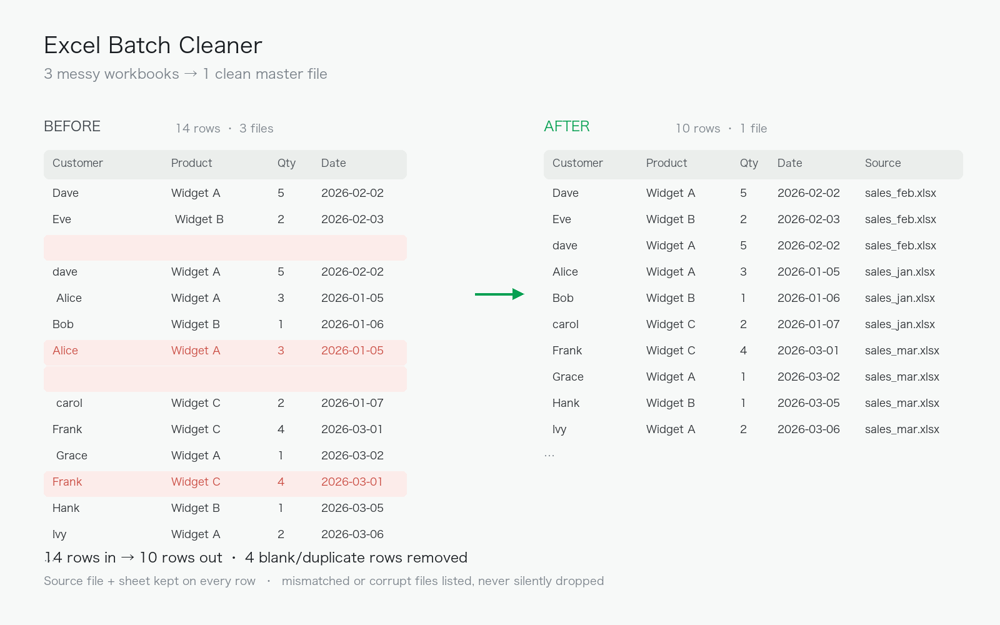
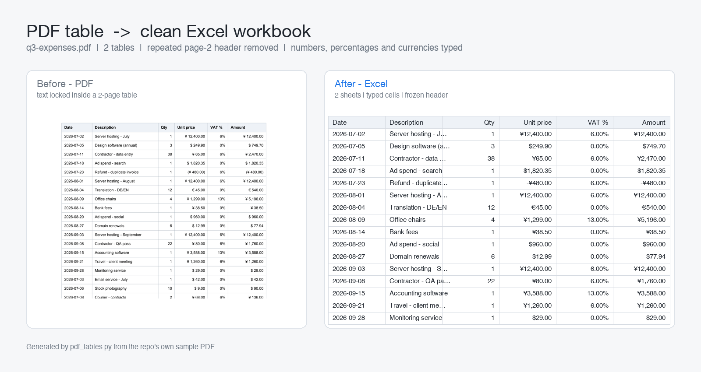
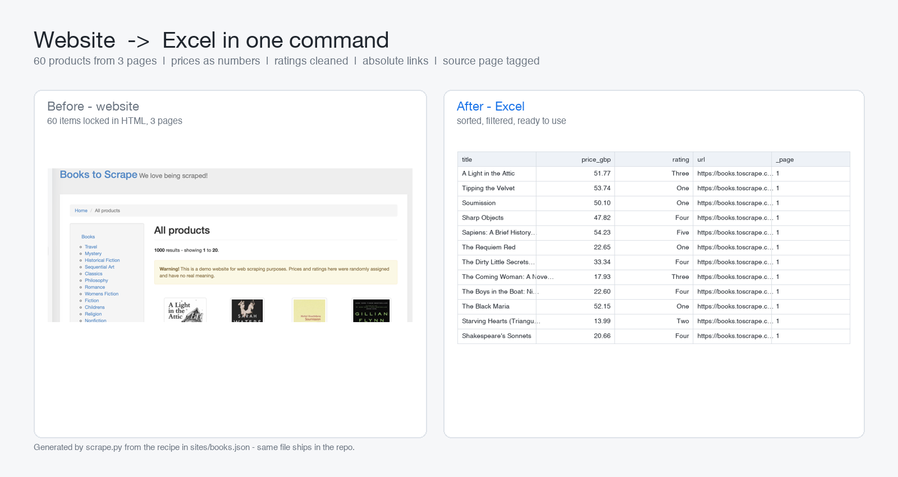

# Python automation tools

Small, tested tools for repetitive spreadsheet and document work.
Each folder is a standalone project with its own README and a runnable demo.

## Projects

### 1. [excel-batch-cleaner](excel-batch-cleaner/)
Merge a folder of messy Excel workbooks into one clean master file.

- Reads every sheet, not just the first
- Strips stray spaces, drops blank rows and exact duplicates
- Validates column layouts — mismatched or corrupt files are reported, never silently dropped
- Tags each row with its source file and sheet
- Prints a before/after report



```bash
cd excel-batch-cleaner
pip install -r requirements.txt
python make_sample_data.py
python excel_cleaner.py
```

### 2. [pdf-table-extractor](pdf-table-extractor/)
Turn PDF tables into a clean, typed Excel workbook — one sheet per table.

- Rejoins tables that continue across pages and drops the header the PDF repeats
- Finds border-less tables too, not just ruled grids
- Discards `Page 2 of 3` style footers
- Converts `1,234.50`, `(480.00)`, `6%`, `¥ 12,400.00` into real Excel numbers with matching formats
- Frozen bold header, auto-filter, columns sized to content



```bash
cd pdf-table-extractor
pip install -r requirements.txt
python make_sample_pdf.py
python pdf_tables.py
```

### 3. [web-scrape-to-excel](web-scrape-to-excel/)
Turn a listing website into a clean Excel workbook — driven by a JSON recipe, not a throwaway script.

- Follows pagination, retries with backoff, de-duplicates across pages
- Fixes broken text encoding (`£51.77` → `£51.77`) and converts prices to real numbers
- Cleans class values (`star-rating Three` → `Three`), resolves relative links
- Optionally opens each detail page for extra columns
- New site = a new JSON file, no code change



```bash
cd web-scrape-to-excel
pip install -r requirements.txt
python scrape.py --pages 3
```

## About

I build small automation tools in Python (pandas, openpyxl, pdfplumber).
Fixed scope, fixed price, tested against real edge cases before delivery — every
claim above is reproducible by running the sample script inside that folder.

Available for freelance work — data cleaning, Excel/CSV automation, PDF extraction,
report generation.

## License

MIT
