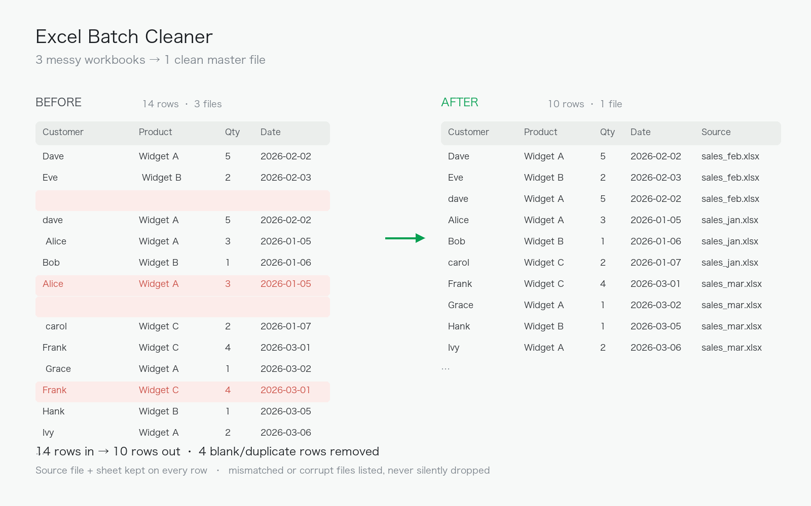

# Excel Batch Cleaner

Merges messy Excel workbooks into one clean master spreadsheet.

## The problem

Small businesses often end up with a folder of Excel exports full of
extra spaces, blank rows and duplicated records. Cleaning them by hand
is slow and error-prone.

## What it does

- Merges every `.xlsx` / `.xls` in a folder (all sheets) into a single file
- Case-insensitive file matching; skips Excel lock files (`~$...`)
- Strips leading/trailing whitespace from headers and text cells (numbers untouched)
- Drops fully-empty rows and exact duplicate rows
- Validates that all files share the same columns — mismatched or corrupt
  files are skipped with a named reason instead of silently breaking the batch
- Tags each row with its source file and sheet
- Never re-ingests its own output on re-runs
- Prints a before/after report

## Quickstart

```bash
pip install -r requirements.txt
python make_sample_data.py                          # demo files (optional)
python excel_cleaner.py                             # -> sample_data/cleaned_master.xlsx
python excel_cleaner.py --input ./raw --output ./done/clean.xlsx
```

## Example

```
  sales_feb.xlsx: 3 clean rows
  sales_jan.xlsx: 3 clean rows
  sales_mar.xlsx: 4 clean rows

Done! 3 file(s) -> sample_data/cleaned_master.xlsx
Rows: 14 -> 10 (4 junk/duplicate rows removed)
```



## Tech

Python 3.14 · pandas

---
