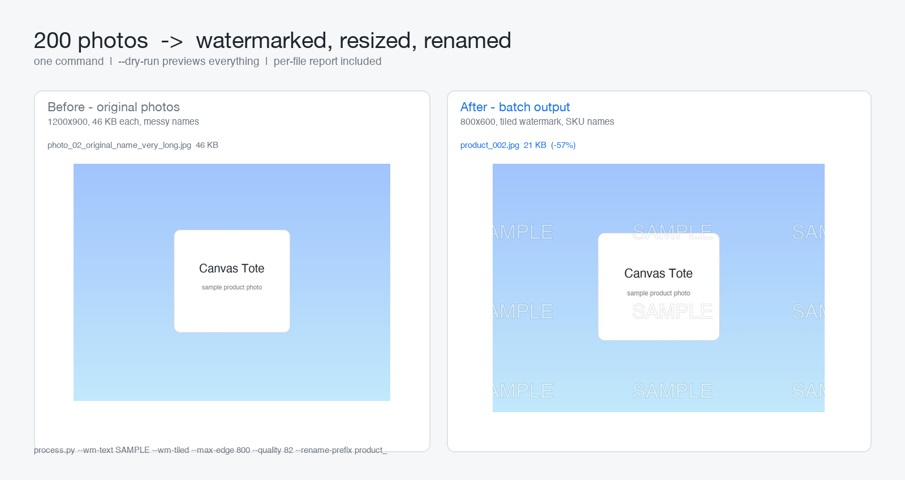

# image-batch-tool

Batch watermark, resize, compress and rename a folder of images — with a dry-run mode and a per-file report.

The gig this replaces: *"I have 200 product photos, put my watermark on them, make them under 500 KB each and rename them to my SKU format."* Doing that by hand in Preview/Photoshop is an afternoon; this is one command.

## What it does

| Step | Flag | Notes |
|---|---|---|
| Text watermark | `--wm-text "SAMPLE"` | tiled or corner, adjustable opacity and size, stroke for readability on light photos |
| Logo watermark | `--wm-logo logo.png` | scaled to 22% of the image, opacity kept |
| Resize | `--max-edge 800` | longest edge; **never upscales** a small image |
| Compress | `--quality 82` | progressive JPEG or WebP |
| Rename | `--rename-prefix SKU --pad 4` | `SKU0001.jpg`, original extension kept |
| Brightness | `--brightness 1.05` | optional quick fix for dark photos |

## Safety first

```bash
python process.py input/ --wm-text "SAMPLE" --max-edge 800 --dry-run
```

`--dry-run` prints the exact plan — which file becomes which name, what would be
done — and writes **nothing**. Only when that looks right do you run it for real.
The originals are never touched; output goes to a separate folder, plus a
`report.txt` with every conversion and the total size saved.

## Install / use

```bash
pip install -r requirements.txt
python process.py                     # builds sample photos, then processes them
python process.py my_photos/ -o out/ --wm-text "© MyShop" --wm-tiled --max-edge 1000 --quality 85
```

Demo run:

```
photo_01_original_name_very_long.jpg -> product_001.jpg  21 KB  text watermark 1200x900 -> 800x600
...
4 image(s)   184 KB -> 80 KB   (57% smaller)
```



## Limits (stated up front)

- Watermark position is per-run, not per-image; a smart "avoid the subject" placement is not attempted.
- No OCR/keyword renaming — names are `PREFIX0001`; mapping from old names to SKUs can be added from a CSV as an add-on.
- HEIC input needs macOS/Pillow with HEIF support; everything else (JPEG/PNG/WebP/TIFF/BMP) works out of the box.

## License

MIT — see [../LICENSE](../LICENSE).
