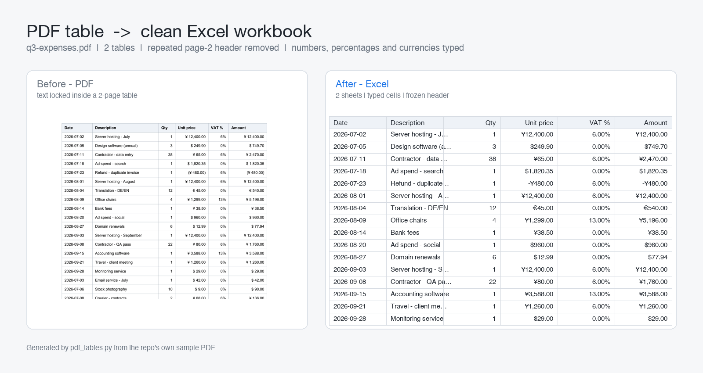

# pdf-table-extractor

Turn PDF tables into a clean, formatted Excel workbook — one sheet per table, real numbers instead of text.

Most "PDF to Excel" converters dump everything into one sheet, keep the header row that the PDF repeats on every page, and turn `1,234.50` into a string. This one doesn't.

## What it handles

| Problem in real PDFs | What the tool does |
|---|---|
| Table continues on page 2 with the header repeated | Stitches the rows back into one table and drops the repeated header |
| Second table on the same page without grid lines | Finds it with a text-position strategy, not just drawn lines |
| `Page 2 of 3`, `Confidential`, `Continued...` | Detected as footer rows and discarded |
| `1,234.50`, `(480.00)`, `6%`, `¥ 12,400.00` | Converted to real Excel numbers (`-480`, `0.06`, `12400`) with a matching number format |
| Mixed currencies in one column | Each cell keeps its own `¥` / `$` / `€` format, and stays numeric |
| `2026-07-02` | Written as a real date, formatted `yyyy-mm-dd` |
| Header buried in the first row | Frozen, bold, auto-filtered, columns sized to content |

## Install

```bash
pip install -r requirements.txt
```

## Use

```bash
python make_sample_pdf.py          # build a 2-page sample invoice to play with
python pdf_tables.py               # reads sample_data/*.pdf -> output/tables.xlsx
python pdf_tables.py invoice.pdf -o out/april.xlsx
```

Report from the bundled sample:

```
Reading 1 PDF file(s)
  q3-expenses.pdf: 2 table(s), 0 footer row(s) dropped
      sheet 'q3-expenses-1': 39 rows x 6 cols (page 1,2)
      sheet 'q3-expenses-2': 4 rows x 3 cols (page 2)

Wrote output/tables.xlsx  (8 KB)
  sheets: 2   data rows: 43   footer rows dropped: 0
```



## How it works

1. **Three extraction strategies per page** — ruled lines, lines+text, and pure text positions. All candidates are collected, and a candidate that overlaps an already accepted table is re-detected only inside the free space, so a loose text-based pass cannot swallow the border-less table sitting under a ruled one.
2. **Row cleaning** — footer patterns and repeated headers are dropped before anything is merged.
3. **Continuation merge** — a table that starts a page with the same header as the table that just ended the previous page is appended to it.
4. **Column typing** — a column is numeric when ≥80% of its cells parse as numbers; each cell then carries its own number format, so a column mixing `¥` and `$` stays readable *and* summable.
5. **Workbook writing** — frozen bold header, auto-filter, column widths from content, dates as dates.

## Limits (stated up front)

- Scanned PDFs (images) are **not** handled — there is no OCR step. Text must be selectable.
- Merged cells are flattened: a vertically merged label appears once, and the cells it covered are left empty.
- A column with fewer than 80% parseable numbers is kept as text on purpose — silently dropping the odd string would corrupt the data.

## License

MIT — see [../LICENSE](../LICENSE).
