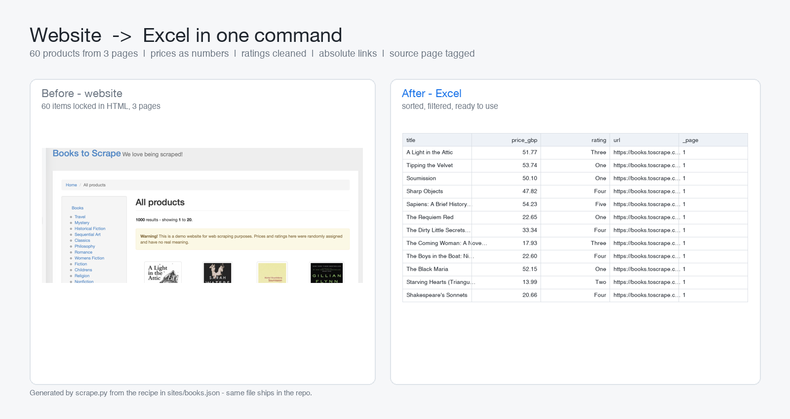

# web-scrape-to-excel

Turn a listing website into a clean Excel workbook with one command — using a JSON recipe, not a throwaway script.

Clients rarely want "a scraper". They want **the same listing as a spreadsheet every month**, without copy-pasting 40 pages. So the site-specific parts live in a small JSON file (selectors, pagination, field types) and the engine here stays generic: change the recipe, not the code.

## What it handles

| Thing that breaks scrapers | What this does |
|---|---|
| `"£51.77"` mojibake | Decodes from the response itself (`apparent_encoding`), prices come out clean |
| 40 pages of listing | Follows the `next` link automatically, with a hard page cap so a loop can't run away |
| Site times out | Retries with exponential backoff, reports which page failed |
| Same item on two pages | De-duplicates on any field (usually the URL) |
| `£51.77`, `1,234.50`, `12,90 €` | Real numbers with a matching format, so Excel can sum them |
| `class="star-rating Three"` | Selector-classes stripped, you get `Three` |
| Relative `/catalogue/x.html` links | Resolved to absolute URLs |
| hammering the server | Rate limiting between requests and detail pages |

## Install

```bash
pip install -r requirements.txt
```

## Use

```bash
python scrape.py                                # sites/books.json, 3 pages, no detail pages
python scrape.py sites/books.json --pages 5     # more pages
python scrape.py sites/books.json --details     # also open each product page
python scrape.py sites/shop.json -o out/shop.xlsx
```

Report from the bundled demo (a site built for scraping practice, 60 items):

```
Scraping books-toscrape - max 3 page(s), 0.5s delay
  page 1: 20 items  https://books.toscrape.com/catalogue/page-1.html
  page 2: 20 items  https://books.toscrape.com/catalogue/page-2.html
  page 3: 20 items  https://books.toscrape.com/catalogue/page-3.html

Wrote output/scraped.xlsx  (11 KB)
  rows: 60   pages: 3   duplicates skipped: 0   detail failures: 0
```



## The recipe

`sites/books.json` — the whole "site knowledge" in 20 lines:

```json
{
  "name": "books-toscrape",
  "start_url": "https://books.toscrape.com/catalogue/page-1.html",
  "item_selector": "article.product_pod",
  "next_selector": "li.next a",
  "dedupe_on": ["url"],
  "numeric": ["price_gbp"],
  "fields": {
    "title": "h3 a@title",
    "price_gbp": "p.price_color",
    "rating": "p.star-rating@class",
    "availability": "p.instock.availability",
    "url": "h3 a@href"
  }
}
```

Field syntax: `"css"` = text, `"css@attr"` = attribute. Adding another site is a new JSON file, not a new script.

## Limits (stated up front)

- **HTML only.** No JavaScript rendering — if the page is built in the browser, this needs Playwright/Selenium, quoted separately.
- **Login walls, captchas, pagination by scrolling** are out of scope for the base price.
- **Be polite**: keep `--delay` at or above 0.5 s and check the site's terms. The demo site exists specifically to be scraped.
- Sites change markup; a recipe is 5 minutes to fix, not a rewrite.

## License

MIT — see [../LICENSE](../LICENSE).
